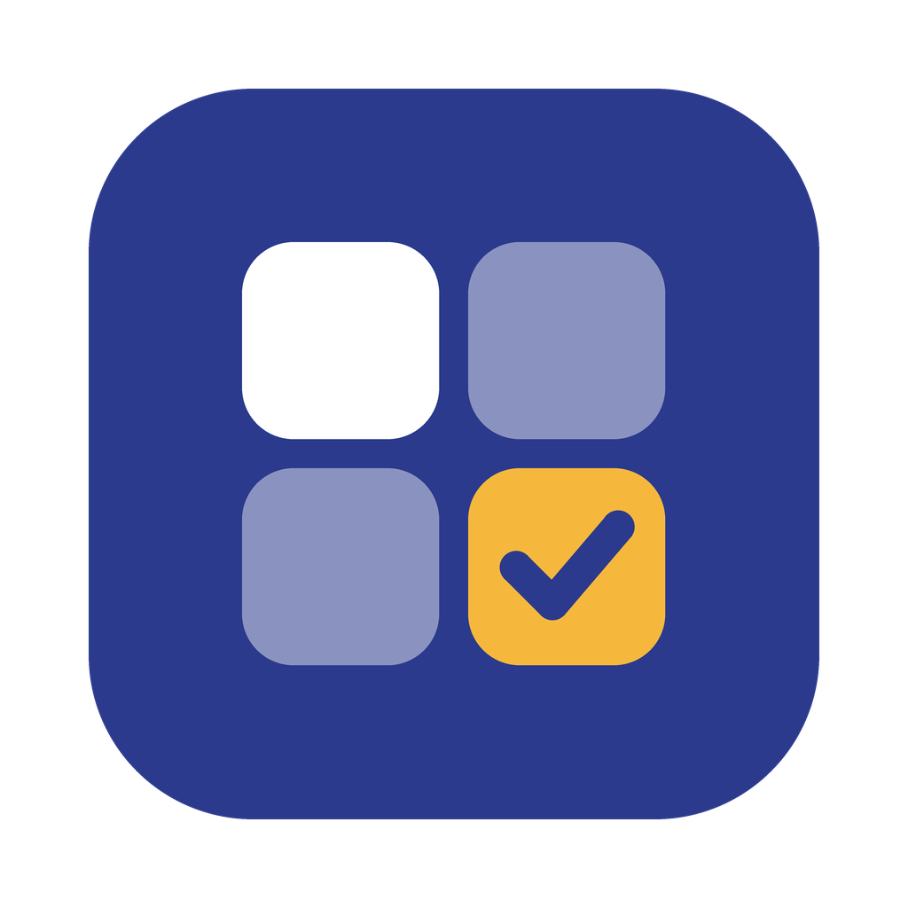
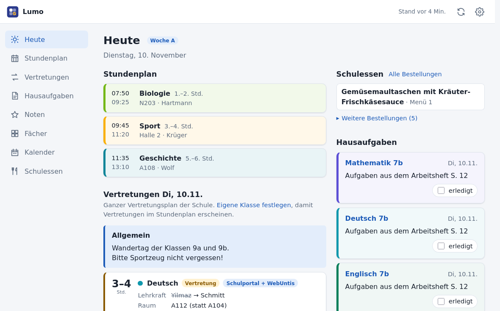
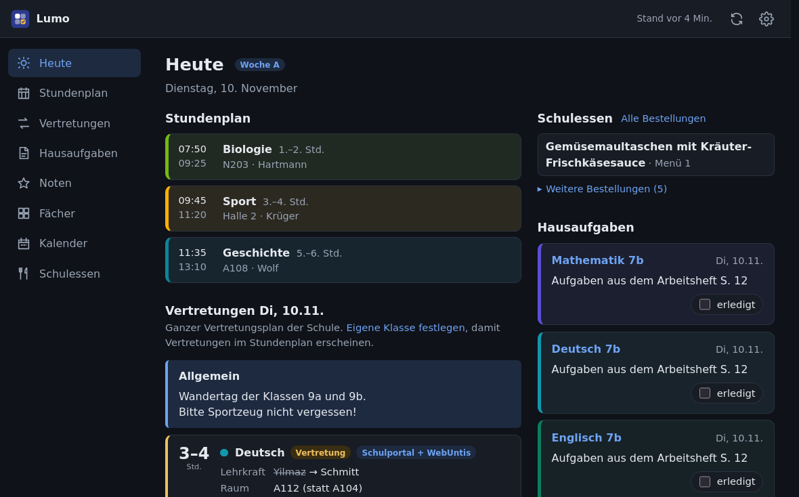
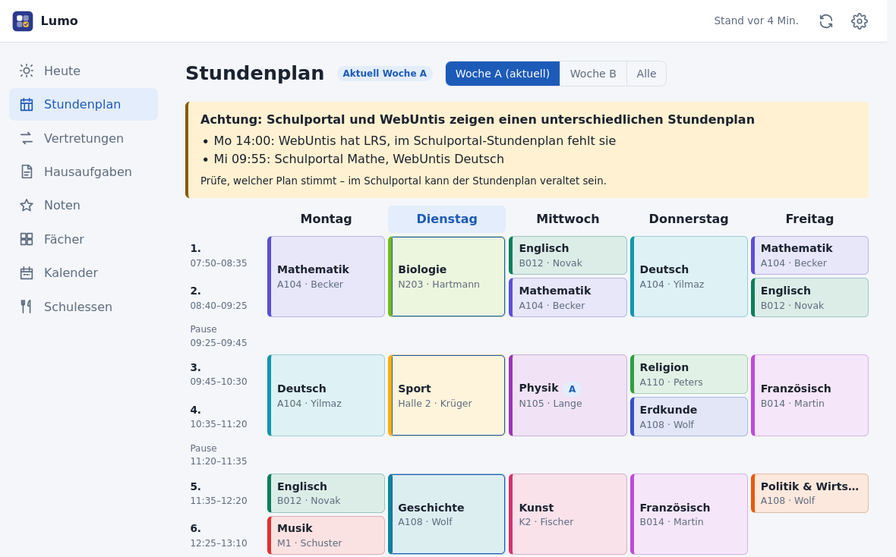
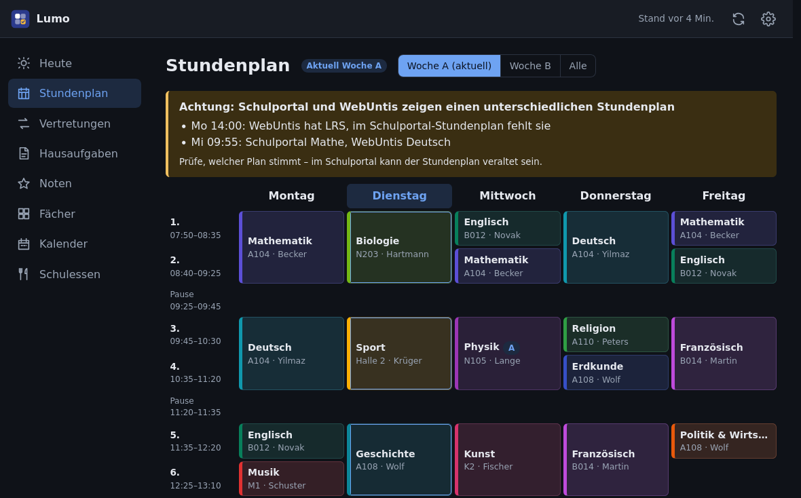

<p align="center">
  
</p>

<h1 align="center">Lumo</h1>

<p align="center"><em>Dein Schulalltag. Einfach organisiert.</em></p>

<p align="center">
  <a href="https://github.com/StefanRiese/lumo/actions/workflows/ci.yml"></a>
  <a href="https://github.com/StefanRiese/lumo/actions/workflows/release.yml"></a>
  <a href="https://github.com/StefanRiese/lumo/releases/latest"></a>
  <a href="LICENSE"></a>
</p>

**Lumo** is a self-hosted companion app for **Schulportal Hessen**: a Dart server (using
[liblanis](https://pub.dev/packages/liblanis)) plus a web UI for Stundenplan, Vertretungsplan,
Hausaufgaben, Noten, Klausuren, Kalender and school meals – and it rings when something changes. It is not an
official app of the state of Hesse.

> **Status:** in use. Server with background sync, web UI, push notifications (ntfy), setup and
> updates in the browser, LXC deployment and desktop apps for Windows and macOS. See
> [CHANGELOG.md](CHANGELOG.md) and [docs/PLAN.md](docs/PLAN.md).

## Screenshots

Invented sample data from the mock server (`dev/mock-server.mjs`); the web UI follows the
light or dark mode of the device.

| Light | Dark |
|---|---|
|  |  |
|  |  |

## Features

- Logs in to Schulportal Hessen and keeps all data in sync in the background (substitutions and
  homework every 15 min, grades and course pages every 2 h, during active hours)
- Pages open right away from the stored data – also after a restart and while the portal is
  down; open pages update themselves when new data arrives
- **Several children** on one server: add Schulportal accounts under *Einstellungen → + Kind*
  and switch between them in the top bar; every child has own data, filters, colors
  and (optional) Caseda / WebUntis login; notifications name the child
- Heute, Stundenplan (A/B weeks), Vertretungen, Hausaufgaben (mark as done in the portal),
  Noten, Fächer / course pages, Kalender with filters; consistent subject colors
- Substitution plan of the whole school with a permanent filter for the own classes (also
  hides types such as „Pausenaufsicht“ and notices such as „Allgemein“), plus search and
  filters on the page; Heute shows substitutions in the lessons of the own classes only
- Optional second source for substitutions: **WebUntis** (a class account is enough). Entries
  that exist in both sources are completed (original teacher struck through, substitute, room
  change), entries only WebUntis has – e.g. for later days – are added and marked; the timetable
  is compared as well: the page Stundenplan warns if Schulportal and WebUntis differ
- School meals from **Caseda Schulmenü** (read-only): ordered meals day by day on the page
  Schulessen, today's meal on Heute, balance with a low-balance hint – ordering stays with Caseda
- Push notifications (ntfy) about new substitutions, homework and grades – from the server,
  so they also arrive while the phone is off
- Setup and all settings in the web UI (school search, login test, password, sync,
  notifications, WebUntis, school meals, network); responsive, dark mode, installable as an app
  that reloads itself after a server update
- Updates from the web UI: the server checks GitHub for new releases and installs them
- REST API with live updates (Server-Sent Events) for own scripts and Home Assistant
  ([docs/API.md](docs/API.md))
- Linux server (systemd service in a Proxmox LXC container) and desktop apps for Windows
  (single exe, tray icon) and macOS (universal app, menu bar icon)

## Project structure

```
lumo/
├── server/     # Dart backend (uses liblanis)
├── web/        # Web UI (plain HTML/CSS/JS, no build step)
├── dev/        # Mock API server for UI development
├── deploy/     # systemd units, install script, release build, desktop apps (deploy/README.md)
└── docs/       # Plan and design notes
```

## Installation (Proxmox LXC / Debian)

```sh
curl -fsSLO https://raw.githubusercontent.com/StefanRiese/lumo/main/deploy/install.sh
bash install.sh
```

Then open the setup link that `install.sh` prints and set up school, Schulportal login and the
web UI password in the browser. Full guide: [deploy/README.md](deploy/README.md).

## Updating

*Einstellungen → Update* shows new releases with their release notes; „Jetzt
aktualisieren“ installs them (LXC, Windows and macOS). On the server alternatively:
`bash /opt/lumo/deploy/install.sh`.

## Windows / macOS

Download `lumo-windows-x64.exe` or `lumo-macos-universal.zip` from the
[releases](https://github.com/StefanRiese/lumo/releases). The app runs in the
notification area / menu bar; right click on the icon to open the web UI. See
[deploy/DESKTOP.md](deploy/DESKTOP.md).

## Development

```sh
cd server
WEB_DIR=../web dart run bin/server.dart
```

Without credentials the server starts in setup mode and logs a setup link
(`http://127.0.0.1:8080/einrichtung?token=…`); the settings are stored in the database next to it.
Alternatively, put `SPH_USERNAME`, `SPH_PASSWORD` and `APP_PASSWORD` into `server/.env`
(see `server/.env.example`; the account is taken over once on the first start, after that
accounts are managed in the web UI). Details: [server/README.md](server/README.md),
[web/README.md](web/README.md), REST API: [docs/API.md](docs/API.md).

UI development without Schulportal: `node dev/mock-server.mjs` (password `demo`;
`MOCK_SETUP=1` shows the setup page, `MOCK_UPDATE=1` an available update).

Debugging against the real services prints counts only: `dart run bin/sph.dart …`,
`bin/caseda.dart --summary`, `bin/untis.dart --summary` (credentials in `server/.env`).

## License

GPL-3.0 (required by the liblanis dependency). See [LICENSE](LICENSE).
